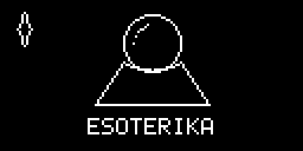
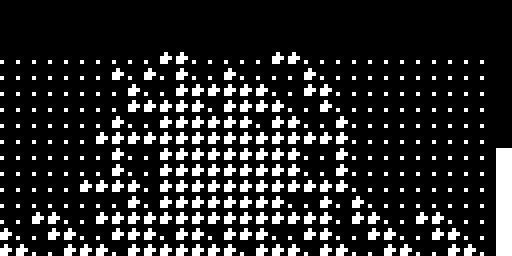
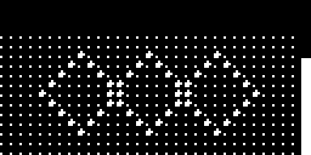
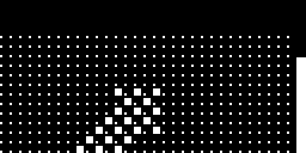

<p align="center">
  
</p>

<h1 align="center">╔══════ E S O T E R I K A ══════╗</h1>

<p align="center">
╔╦╗╔╦╗╔╦╗╔╦╗╔╦╗╔╦╗╔╦╗╔╦╗╔╦╗╔╦╗╔╦╗<br>
╚╩╝╚╩╝╚╩╝╚╩╝╚╩╝╚╩╝╚╩╝╚╩╝╚╩╝╚╩╝╚╩╝
</p>

<p align="center">
░▒▓█ &nbsp; a sealed tonal codex for the Digitone mk1 &nbsp;·&nbsp; OS 1.44 &nbsp; █▓▒░
</p>

```
┌─────────────────────────────────────────────────────────────┐
│  AS ABOVE, SO BELOW.                                        │
│  THE MACRO CONTAINS THE WHOLE.                              │
│  THREE CHAMBERS TURN BENEATH ONE SKY.                       │
└─────────────────────────────────────────────────────────────┘
```

| ┃ R U I N ┃ | ┃ X T A L ┃ | ┃ V O I D ┃ | ┃ G E N E S I S ┃ |
|:---:|:---:|:---:|:---:|
|  |  |  |  |
| ┃ the iron choir ┃ | ┃ the twin moons ┃ | ┃ the wandering star ┃ | ┃ before the lattice ┃ |
| what is whole is broken; what is broken is made holy | the field opens left and right; the echo remembers | it moves without moving; the arrow is its shadow | the crystal dreamed, and the dream remained |

━━━━━━━━━━━━━━━━━━━━━━━━━━━━━━━━━━━━━━━━━━━━━━━━━━━━━━━━━━━━━━━

```
╔══════════════════════════════════════════════════════════════╗
║  T H E   S E A L S                                           ║
╚══════════════════════════════════════════════════════════════╝
```

| glyph | vessel | whisper |
|:--:|---|---|
| ┃◈┃ | `esoterika-1.0-os1.44.elemod` | the vessel and the page-host |
| ┃△┃ | `ruin-1.1-os1.44.elemod` | fold · crush |
| ┃◇┃ | `xtal-1.1-os1.44.elemod` | pan · wrmz |
| ┃⟁┃ | `void-1.0-os1.44.elemod` | wob · pan |

```
┌─────────────────────────────────────────────────────────────┐
│  CORE:  core-dn1-4.0-os1.44.elemod   (not given here)       │
│  HASHES: elemods/SHA256SUMS                                 │
│  NO FIRMWARE · NO .SYX · NO SOURCE                          │
└─────────────────────────────────────────────────────────────┘
```

### ┃ the rite ┃

1. Bear the core into **elekloader**.
2. Set **ESOTERIKA** as the vessel. Add any of the three names.
3. Mark the seal `1.1 ` — four glyphs; the last is silence.
4. Return the fire with **Transfer**.

> A name alone is empty. The vessel is required.

━━━━━━━━━━━━━━━━━━━━━━━━━━━━━━━━━━━━━━━━━━━━━━━━━━━━━━━━━━━━━━━

```
╔══════════════════════════════════════════════════════════════╗
║  T H E   D I G I T A K T   G A T E   I S   S E A L E D       ║
║  its book is kept, unopened, until the hour is right         ║
╚══════════════════════════════════════════════════════════════╝
```

<p align="center">
░ as above, so below &nbsp;┃&nbsp; as within, so without &nbsp;┃&nbsp; as the macro, so the tone ░
</p>

<p align="center">
<sub>unofficial · unsupported · not affiliated with or endorsed by Elektron · GPL-2.0-or-later</sub>
</p>
