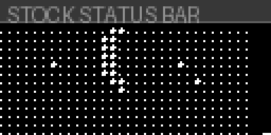

# ESOTERIKA elemods

Five Elemods for the **Elektron Digitone mk1 / Digitone Keys (OS 1.44)**: one
**container/host** and four guest packs. **No firmware / `.syx` is included.**
The Digitakt 1.54 port is parked and is not part of this package.

| file | role | requires |
|---|---|---|
| `esoterika-1.0-os1.44.elemod` | **host/container** | `core-dn1-4.0-os1.44.elemod` |
| `ruin-1.1-os1.44.elemod` | guest | core + `esoterika-1.0-os1.44` |
| `xtal-1.1-os1.44.elemod` | guest | core + `esoterika-1.0-os1.44` |
| `void-1.1-os1.44.elemod` | guest | core + `esoterika-1.0-os1.44` |
| `crepus-1.0-os1.44.elemod` | guest (new in 1.2) | core + `esoterika-1.0-os1.44` |

## Install

1. Load the matching core in elekloader (not included here).
2. **ESOTERIKA is the container and page host.** Select it every time. It owns
   the master-view and audio sites, the boot splash, the page cycle, and the
   single output ceiling, and has no page of its own. Do **not** also install the
   standalone `esoterika-splash` mod; its intro sites overlap the host.
3. Add **any combination** of guest packs: RUIN, XTAL, VOID and CREPUS. Guests
   have 0 sites and register their page and audio chain with ESOTERIKA. With all
   four installed the audio path is RUIN → CREPUS → XTAL → VOID.
4. Tick the core, ESOTERIKA and the chosen guests, set the OS version tag to the
   4-character `1.2 ` (trailing space), and build.
5. Flash the resulting firmware with Transfer.

A guest without ESOTERIKA does not link. The Digitakt mk1 elemods are not part
of this release.

Shared behaviour:

- **FUNC + turn** snaps the edited parameter to max (right) or min (left); the
  mode encoder snaps to mode 5/0.
- RUIN and XTAL save independently in two 32 B halves of the reserved DN store
  (`pattern+0x1BB0`/`+0x1BD0`). VOID uses its own `ESO5` block on a second
  reserved MIDI track (`+0x17E0`, CH 15). Kit memory is never written. The
  captured base layer is saved too.
- The background lattice fills the strip beside the depth bar with one extra
  dot column.
- CREPUS stores in `ESO7` at `pattern+0x1800` (second half of VOID's CH 15
  block). Kit memory is never written.

## RUIN 1.1 (guest)

- FOLD + CRUSH only; no RING, no delay line.
- Six mode pairings: **TRASH + CRUNCH**, **CLEAN + REDUX**, **DIST + CRUNCH**,
  **MUD + BITS**, **CLEAN + CRUNCH**, **DIST + SRR** (on-screen titles: `TRASH`,
  `REDUX`, `DIST`, `MUD`, `CLEAN`, `SRR`).
- `A` = macro on/off, `D` = mode, `B/C/E/F/G/H` = amount.
- OFF: `RUIN` scrolls right-to-left; the depth bar stays visible.
- ON: a round dotgrid bomb with a five-cell fuse and a flashing spark.
- From 35% depth, pulsing `( )` arcs appear outside the bomb; from 70% depth
  the bomb is replaced by a dense ring/ray blast.
- Changing mode flashes a short mode title across the top dot rows.
- Each mode has independent fold/crush curves, max depths and a macro-ramped
  output trim.

## XTAL 1.1 (guest)

- Autopan/stereo PAN + WRMZ delay, no other FX.
- Six modes with different WRMZ time/feedback/tone/mod/rate and stereo PAN
  speed: **SLOW**, **TIGHT**, **WIDE**, **ECHO**, **FLOSS**, **PANDEMONIUM**.
  WRMZ character is fixed per mode; depth scales PAN and delay mix.
- `A` = macro on/off, `D` = mode, `B/C/E/F/G/H` = depth.
- OFF: `XTAL` scrolls right-to-left; the depth bar stays visible.
- ON: three diamond outlines. At depth 0 they overlap into one; as depth rises
  the outer diamonds separate L/R and move up/down per mode. The centre diamond
  stays fixed.
- Changing mode flashes a short mode title across the top dot rows.

## VOID 1.1 (guest)

- WOB pitch wobble + PAN autopan, one namespaced `void_wave` engine that runs
  both groups in the same block, so pitch and pan can move together.
- Six depth/speed modes: **DRIFT**, **SWAY**, **TURN**, **SPIN**, **RUSH**,
  **ORBIT** (on-screen titles match). The amount scales both depths; the speeds
  are fixed per mode.
- `A` = macro on/off, `D` = mode, `B/C/E/F/G/H` = amount.
- OFF: `VOID` scrolls right-to-left; the depth bar stays visible.
- ON: one big, bold arrow. PAN moves x, WOB moves y, and the heading is the
  trajectory velocity, so it turns while scrolling laterally. At amount 0 a
  single bold centre block is shown. SPIN's visual travel is capped to one cell;
  its audio pan depth is unchanged.
- `void_wave` is namespaced, so VOID can be installed alongside XTAL.
- VOID 1.1: wet ramps reach true zero (no stuck flanger after OFF) and the
  amount/depth stops at 126 to avoid the 127 edge.

## CREPUS 1.0 (new in 1.2)

- One-knob master tilt / DJ filter. Amount is centred at 64: below 64 tilts
  dark, above 64 bright; `A` = on/off, `D` = mode, `B/C/E/F/G/H` = amount.
- Six modes: **TILT**, **DAWN**, **NOON**, **DUSK**, **ECLIPSE**, **UMBRA**.
  TILT is the pure two-shelf EQ motion; the others add a resonant LP/HP sweep,
  with ECLIPSE as a moving band and UMBRA as the aggressive end.
- OFF: `CREPUS` scrolls right-to-left. ON: an encoder-driven full-screen
  sun/moon dial; the moon rises as the sun sets, with six pulsating stars
  between them.
- Store: `ESO7` v3 at `pattern+0x1800` (second half of VOID's CH 15 block).
- Render-out order 59; page priority 40.
- **New in 1.2.** Hardware validation is still in progress; report any issues.

## Hashes

See `SHA256SUMS`.
